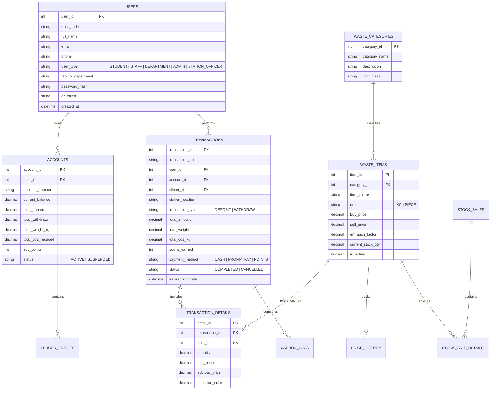

# แผนแม่บทระบบ RBRU Recyclable Waste Bank Management
## ระบบบริหารจัดการธนาคารขยะรีไซเคิล มหาวิทยาลัยราชภัฏรำไพพรรณี
### (RBRU Recyclable Waste Bank Management System)

> **เอกสารวิเคราะห์ระบบต้นแบบและข้อเสนอโครงการเชิงสถาปัตยกรรมระบบ (System Blueprint & Master Plan)**  
> **อ้างอิงบทเรียนและกรณีศึกษา:** ระบบบริหารจัดการธนาคารขยะรีไซเคิล มหาวิทยาลัยมหิดล ออนไลน์ (MU Recyclable)  
> **สังกัด:** มหาวิทยาลัยราชภัฏรำไพพรรณี (RBRU Green University & UI GreenMetric Campus)

---

## 1. บทสรุปการศึกษาและถอดบทเรียนจากระบบ MU Recyclable (มหาวิทยาลัยมหิดล)

จากการศึกษาโครงสร้างและแนวทางการดำเนินงานของระบบ **MU Recyclable Waste Bank Management System** ([muit.mahidol.ac.th](https://muit.mahidol.ac.th/docs/users-guide/manual-mu-administration/manual-mu-recyclable/)) ซึ่งพัฒนาโดยกองเทคโนโลยีสารสนเทศ ร่วมกับกองกายภาพและสิ่งแวดล้อม มหาวิทยาลัยมหิดล พบข้อสรุปและแนวคิดหลักที่นำมาปรับใช้กับ **ระบบ RBRU Recyclable Waste Bank Management** ได้ดังนี้:

### 1.1 กระบวนการทางธุรกิจหลัก (Core Business Workflow)
1. **การจำลองกลไกธนาคารพาณิชย์ (Virtual Banking Concept):** ขยะรีไซเคิล = ทรัพย์สินที่มีมูลค่า สามารถนำมาเปิดบัญชี ฝาก สะสมยอดเงิน และถอนเงินสดได้เสมือนสมุดเงินฝากธนาคาร
2. **การรวมศูนย์การยืนยันตัวตน (Centralized Authentication):** ใช้โครงสร้างบัญชีผู้ใช้งานระดับมหาวิทยาลัย (SSO / University Account) ทำให้บุคลากรและนักศึกษาไม่ต้องสร้างบัญชีใหม่ ลดปัญหาข้อมูลซ้ำซ้อน
3. **โครงสร้างบัญชีเงินฝาก 3 ระดับ (Account Perspective):**
   * **ภาพรวมบัญชีเงินฝาก (Account Overview):** แสดงสถานะบัญชี ยอดเงินคงเหลือสุทธิ และรายการทำธุรกรรมล่าสุด
   * **การเคลื่อนไหวทางบัญชี (Statement / Transactions):** ค้นหาย้อนหลังตามช่วงวันที่ และมีฟังก์ชัน **Drill-down (Double Click)** เพื่อดูรายละเอียดลึกถึงประเภท ชนิด น้ำหนัก และราคารับฝากของขยะแต่ละชิ้นในรายการนั้น
   * **ข้อมูลบัญชีผู้ฝาก (Profile / Entity Data):** ระบุสังกัด คณะ กอง หรือหน่วยงาน เพื่อรองรับการจัดเก็บสถิติขยะระดับหน่วยงาน
4. **จุดบริการทางกายภาพร่วมกับระบบดิจิทัล (Phygital Integration):** มีจุดให้บริการรับฝากประจำ (เช่น อาคารอนุรักษ์สิ่งแวดล้อม, อาคารพัฒนดล) โดยเจ้าหน้าที่ใช้งานระบบผ่าน Web-based ในการชั่งน้ำหนักและบันทึกข้อมูลเข้าบัญชีสมาชิกแบบ Real-time
5. **การขับเคลื่อนนโยบายมหาวิทยาลัย (Policy-Driven Alignment):** ระบบไม่ได้ทำหน้าที่เพียงแค่บันทึกรายรับ-รายจ่าย แต่เป็นกลไกหลักในการขับเคลื่อนนโยบาย **Zero Waste to Landfill** และเศรษฐกิจหมุนเวียน (Circular Economy)

---

## 2. วิสัยทัศน์และเป้าประสงค์ของระบบ RBRU Recyclable Waste Bank Management

นำบทเรียนจาก MU Recyclable มายกระดับให้ตอบโจทย์บริบทของ **มหาวิทยาลัยราชภัฏรำไพพรรณี** โดยขยายขีดความสามารถเพิ่มเติม ได้แก่:
1. **รองรับเกณฑ์ UI GreenMetric World University Rankings (หมวด Waste: WS):** เชื่อมโยงน้ำหนักขยะที่นำฝากเข้ากับสูตรคำนวณการลดก๊าซเรือนกระจก (Carbon Footprint / Greenhouse Gas Reduction: $\text{kgCO}_2\text{eq}$) ตามมาตรฐาน อบก. (TGO)
2. **ระบบคะแนนกรีนพอยท์ (RBRU Green Coin / Eco-Points):** นอกเหนือจากการฝากเป็นเงินสด สมาชิกสามารถเลือกสะสมแต้มเพื่อแลกชั่วโมงกิจกรรมจิตอาสา/กิจกรรมนักศึกษา หรือส่วนลดร้านค้าสหกรณ์มหาวิทยาลัย
3. **รองรับทั้งบัญชีบุคคลและบัญชีองค์กร/หน่วยงาน (Green Office Support):** แต่ละสาขาวิชา คณะ สำนัก และกอง สามารถเปิดบัญชีหน่วยงาน เพื่อแข่งขันจัดอันดับสำนักงานสีเขียวภายในมหาวิทยาลัย
4. **สถาปัตยกรรม Web-based ที่ติดตั้งบนเซิร์ฟเวอร์ท้องถิ่นและคลาวด์ได้ง่าย (XAMPP / PHP / MySQL / REST API):** ยืดหยุ่น ดูแลรักษาง่าย และเชื่อมต่อกับตราชั่งดิจิทัลและ LINE OA ได้ในอนาคต

---

## 3. สถาปัตยกรรมระบบ (System Architecture & Module Design)

```mermaid
flowchart TD
    subgraph Users["กลุ่มผู้ใช้งาน (User Actors)"]
        A1["นักศึกษา / บุคลากร (Members)"]
        A2["คณะ / สำนัก / ชมรม (Units/Depts)"]
        A3["เจ้าหน้าที่ประจำจุดรับฝาก (Station Staff)"]
        A4["ผู้ดูแลระบบ & คณะกรรมการสิ่งแวดล้อม (Admins)"]
        A5["ผู้รับซื้อขยะภายนอก (Recyclers/Buyers)"]
    end

    subgraph Portal["ระบบส่วนหน้า (Frontend Portals)"]
        B1["Member Portal (Responsive Web)"]
        B2["Station POS & Weighing Station App"]
        B3["Admin & Executive Dashboard"]
    end

    subgraph BackendEngine["ระบบประมวลผลกลาง (Core Engines)"]
        C1["Authentication & RBAC (RBRU SSO / Local)"]
        C2["Deposit & Weighing Transaction Engine"]
        C3["Dynamic Price & Catalog Management"]
        C4["Digital Passbook & Ledger System"]
        C5["GHG & Carbon Reduction Calculator (TGO)"]
        C6["Outflow Sale & Stock Inventory Engine"]
    end

    subgraph DataStore["ฐานข้อมูล (MySQL Relational DB)"]
        D1[(ตารางสมาชิกและสิทธิ์ users/roles)]
        D2[(ตารางหมวดหมู่และราคาขยะ waste_items/prices)]
        D3[(ตารางบันทึกการฝาก transactions/details)]
        D4[(ตารางสมุดบัญชีเงินฝาก accounts/ledgers)]
        D5[(ตารางคำนวณคาร์บอนฟุตพริ้นท์ carbon_logs)]
        D6[(ตารางจำหน่ายออกคลังขยะ stock_sales)]
    end

    Users --> Portal
    Portal --> BackendEngine
    BackendEngine --> DataStore
```

---

## 4. โครงสร้างโมดูลระบบโดยละเอียด (System Functional Modules)

### 4.1 โมดูลการยืนยันตัวตนและการจัดการสมาชิก (Authentication & Membership Module)
* **การลงทะเบียนและเข้าสู่ระบบ:**
  * รองรับทั้งการเข้าสู่ระบบผ่าน Google Workspace (@rbru.ac.th) และระบบบัญชีมาตรฐาน
  * ประเภทสมาชิก 2 รูปแบบ:
    1. **สมาชิกบุคคล (Individual Member):** นักศึกษา (ระบุรหัส นศ., คณะ, สาขา) และบุคลากร (ระบุสังกัดหน่วยงาน)
    2. **สมาชิกหน่วยงาน (Department/Green Office Member):** คณะ สำนัก สถาบัน และอาคารเรียน
* **รหัสสมาชิกและ Virtual Member Card:**
  * รหัสบัญชีสมาชิกอัตโนมัติ พร้อมสร้าง **QR Code ประจำตัว** บนสมาร์ตโฟน สำหรับยื่นสแกนที่จุดรับฝากได้ทันทีโดยไม่ต้องพกสมุดเล่มจริง

### 4.2 โมดูลหมวดหมู่ขยะและระบบราคารับฝากแบบไดนามิก (Waste Catalog & Dynamic Pricing)
* จัดหมวดหมู่ขยะตามมาตรฐานการรีไซเคิลของกระทรวงทรัพยากรธรรมชาติฯ และ อบก.:
  1. **กลุ่มกระดาษ:** กระดาษขาวดำ, กระดาษหนังสือพิมพ์, ลังกระดาษลูกฟูก, กระดาษย่อย/เศษกระดาษ
  2. **กลุ่มพลาสติก:** พลาสติกใส (PET), พลาสติกขุ่น (HDPE), พลาสติกรวม/ถุงแกง, ขวดแก้ว/ขวดพลาสติกสี
  3. **กลุ่มโลหะและอลูมิเนียม:** กระป๋องอลูมิเนียมเครื่องดื่ม, เศษเหล็กหนา/บาง, สังกะสี, ทองแดง/ทองเหลือง
  4. **กลุ่มแก้ว:** ขวดเบียร์/ขวดสุรา, ขวดแก้วรวม, เศษแก้วแตก
  5. **กลุ่มขยะอิเล็กทรอนิกส์ (E-Waste):** อุปกรณ์คอมพิวเตอร์, สายไฟเก่า, แบตเตอรี่, ตลับหมึก
* **การกำหนดราคา 2 ชั้น (Two-Tier Pricing Structure):**
  * **ราคารับฝากเข้า (Member Buying Price - บาท/กก.):** มูลค่าที่เครดิตเข้าบัญชีสมาชิก
  * **ราคาจำหน่ายออก (Outflow Selling Price - บาท/กก.):** ราคาที่ร้านรับซื้อของเก่ารับซื้อไป
  * **ส่วนต่างกำไร (Operating Margin):** เข้ากองทุนธนาคารขยะ มรภ.รำไพพรรณี เพื่อใช้เป็นค่าบริหารจัดการและสวัสดิการ
* **ค่าสัมประสิทธิ์การลดก๊าซเรือนกระจก (Emission Factor):**
  * กำหนดค่า $\text{kgCO}_2\text{eq}$ ต่อกิโลกรัมสำหรับขยะแต่ละชนิด เช่น พลาสติก PET $\approx 1.55\text{ kgCO}_2\text{eq/kg}$, อลูมิเนียม $\approx 9.13\text{ kgCO}_2\text{eq/kg}$

### 4.3 โมดูลจุดรับฝากและชั่งน้ำหนัก (Deposit & Weighing Station Module)
* ออกแบบหน้าจอ **Station POS** สำหรับเจ้าหน้าที่ประจำจุด:
  1. สแกน QR Code สมาชิก หรือค้นหาด้วยชื่อ/รหัส นศ./เบอร์โทรศัพท์
  2. เลือกรหัสประเภทขยะ (มี Quick Shortcut และค้นหาตามหมวด)
  3. บันทึกน้ำหนัก (กรอกตัวเลข หรือดึงค่าน้ำหนักผ่านเครื่องชั่งดิจิทัล)
  4. ระบบคำนวณอัตโนมัติ: $\text{น้ำหนัก (กก.)} \times \text{ราคาต่อหน่วย (บาท)} = \text{ยอดเงินสุทธิ}$
  5. ระบบคำนวณ Carbon Offset อัตโนมัติ: $\text{น้ำหนัก} \times \text{Emission Factor} = \text{CO}_2\text{ ที่ลดได้}$
  6. กดบันทึกธุรกรรม (Confirm Deposit): ข้อมูลจะเข้าบัญชีสมาชิกทันที พร้อมพิมพ์ใบเสร็จ หรือส่ง E-Slip ผ่านหน้าจอมือถือ

### 4.4 โมดูลสมุดบัญชีเงินฝากและเบิกถอน (Digital Passbook & Withdrawal Module)
* ถอดแบบแนวคิด **MU Recyclable** ครบถ้วน:
  * **Overview Tab:** ยอดเงินคงเหลือปัจจุบัน (Account Balance), ปริมาณขยะสะสมรวม (กก.), และปริมาณก๊าซเรือนกระจกที่ช่วยลดได้
  * **Statement Tab (การเคลื่อนไหวทางบัญชี):**
    * ตารางประวัติรายการ (วันที่, จุดบริการ, รหัสธุรกรรม, ฝาก/ถอน, ยอดเงิน, ยอดคงเหลือ)
    * **ระบบ Drill-down Detail:** คลิกที่รายการฝากใดๆ เพื่อเปิด Modal แสดงรายการขยะที่นำฝากในรอบนั้นอย่างละเอียด (เช่น รายการที่ 1: ขวด PET 3.5 กก., รายการที่ 2: ลังกระดาษ 10.2 กก.)
  * **ระบบถอนเงิน (Withdrawal Workflow):**
    * สมาชิกสามารถกดส่งคำขอถอนเงิน (Request Withdrawal) เข้าพร้อมเพย์ (PromptPay) หรือแจ้งรับเงินสด ณ จุดบริการ
    * เจ้าหน้าที่การเงินตรวจสอบและยืนยันการจ่ายเงิน พร้อมอัปเดตสถานะบัญชี

### 4.5 โมดูลแดชบอร์ดความยั่งยืนและ UI GreenMetric Analytics
* หน้าต่างสำหรับผู้บริหาร คณะกรรมการสิ่งแวดล้อม และสาธารณะ:
  * **Real-time Waste Metric:** น้ำหนักขยะรีไซเคิลสะสมแยกตามหมวดหมู่ (Paper, Plastic, Metal, Glass, E-waste)
  * **Greenhouse Gas Avoided Dashboard:** รวมค่า $\text{tCO}_2\text{eq}$ สะสมเทียบเท่ากับการปลูกต้นไม้กี่ต้น
  * **Leaderboard & Ranking:** จัดอันดับสุดยอดผู้พิทักษ์สิ่งแวดล้อม (Top 10 นักศึกษา, บุคลากร, และคณะที่มีการนำขยะมารีไซเคิลสูงสุด)
  * **UI GreenMetric Export:** ปุ่มส่งออกรายงานในรูปแบบตารางและกราฟตามแบบฟอร์มประเมิน Green Campus ของ มรภ.รำไพพรรณี

### 4.6 โมดูลคลังขยะและการจำหน่ายออก (Inventory & Outflow Sales)
* บริหารจัดการขยะที่กองสะสม ณ อาคารธนาคารขยะ:
  * ตรวจสอบปริมาณขยะคงคลังรอจำหน่าย (Current Physical Stock)
  * บันทึกการชั่งขายให้ผู้รับซื้อของเก่า/โรงงานรีไซเคิล (Sale Order)
  * สรุปงบดุลบัญชีกองทุนธนาคารขยะ (รายได้จากการขาย - ต้นทุนรับซื้อ = กำไรสะสมกองทุน)

---

## 5. การออกแบบโครงสร้างฐานข้อมูล (Database Schema Blueprint)

---

## 6. แผนที่นำทางการพัฒนา (Development Roadmap)

| ระยะ (Phase) | รายละเอียดงาน (Deliverables) | ระยะเวลาประเมิน |
| :--- | :--- | :---: |
| **Phase 1: Architecture & UI/UX Design** | ศึกษาดูงานระบบ MU Recyclable, ออกแบบโครงสร้างฐานข้อมูล, จัดทำ User Flow และ Wireframes | สัปดาห์ที่ 1 - 2 |
| **Phase 2: Core Engine & Station POS** | พัฒนาระบบยืนยันตัวตน, ทะเบียนขยะ/ราคา, และระบบบันทึกการฝากขยะประจำจุด (Weighing Station) | สัปดาห์ที่ 3 - 5 |
| **Phase 3: Digital Passbook & Member Portal** | พัฒนาระบบสมุดบัญชีออนไลน์, ประวัติ Statement แบบ Drill-down, และระบบขอเบิกถอน | สัปดาห์ที่ 6 - 7 |
| **Phase 4: Carbon Metrics & Executive Dashboard** | พัฒนาระบบคำนวณ GHG Reduction, Leaderboard, และระบบคลังสินค้าจำหน่ายออก (Stock Sales) | สัปดาห์ที่ 8 - 9 |
| **Phase 5: Testing, Training & Pilot Launch** | ทดสอบระบบ (UAT), อบรมเจ้าหน้าที่จุดรับฝาก และเริ่มทดลองใช้งานจริง ณ จุดรับฝาก มรภ.รำไพพรรณี | สัปดาห์ที่ 10 - 12 |

---

## 7. ปัจจัยสู่ความสำเร็จ (Critical Success Factors)

1. **User Experience ที่สะดวกรวดเร็ว:** การชั่งน้ำหนักและบันทึกข้อมูลต้องทำเสร็จภายในไม่เกิน 60 วินาทีต่อสมาชิก 1 ท่าน เพื่อลดแถวคอยที่จุดรับฝาก
2. **ความโปร่งใสของราคา:** มีการประกาศราคารับฝากขยะแต่ละประเภทอย่างชัดเจนผ่านหน้าเว็บ พร้อมแสดงการเคลื่อนไหวของราคาตลาด
3. **การสร้างแรงจูงใจ (Gamification & Incentives):** ผสานคะแนนสะสมความดี (Green Points) เข้ากับสิทธิประโยชน์ของนักศึกษาและบุคลากรในมหาวิทยาลัย
4. **ความแม่นยำในการชั่งและคำนวณคาร์บอนฟุตพริ้นท์:** การคำนวณปริมาณการลดการปล่อยก๊าซเรือนกระจกที่อ้างอิงมาตรฐาน อบก. จะช่วยยกระดับอันดับความยั่งยืนของมหาวิทยาลัยในเวที UI GreenMetric ได้อย่างเป็นรูปธรรม
