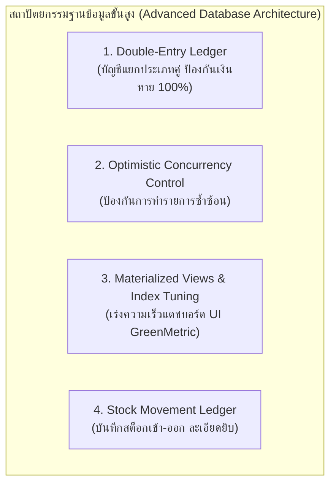
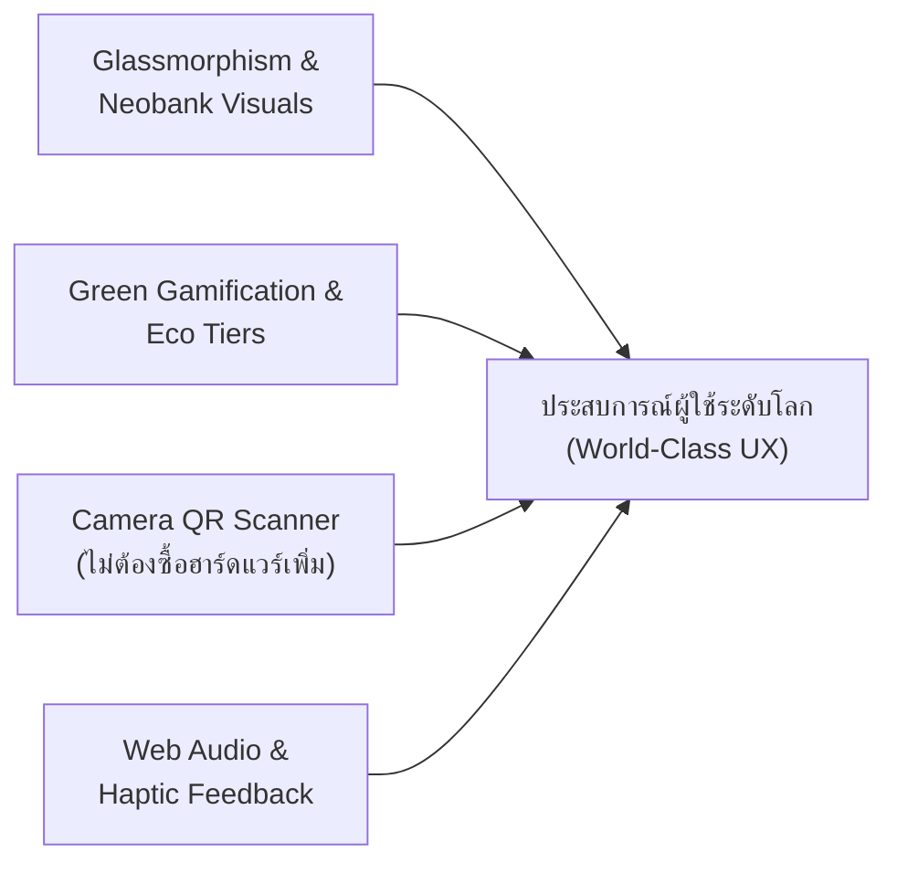

# ข้อเสนอแนะเชิงวิชาชีพ: ยกระดับสถาปัตยกรรมฐานข้อมูล และ UI/UX ระบบ RBRU Recyclable Waste Bank Management
## Database Architecture, Neobank UI/UX & Green Gamification Blueprint

> **บทวิเคราะห์และข้อเสนอแนะโดย:** Database Architect & Lead UI/UX Engineer  
> **เป้าหมาย:** พัฒนาระบบให้มีความทันสมัยสูงสุด ใช้งานง่าย ลื่นไหล (Zero Friction) สร้างแรงจูงใจในการคัดแยกขยะ และมีความปลอดภัยทางบัญชีระดับสถาบันการเงิน (FinTech Standards)

---

## 1. การยกระดับระบบฐานข้อมูล (Database Architecture Modernization)

จากโครงสร้างปัจจุบัน เพื่อให้ระบบรองรับการตรวจสอบบัญชี (Audit Trail) การขยายตัวของข้อมูล (High Scalability) และความถูกต้องแม่นยำทางธุรกรรม 100% ขอเสนอแนะการปรับปรุง 4 มิติ:

### 1.1 นำระบบ Double-Entry Ledger (บัญชีแยกประเภทคู่) มาใช้
* **ปัญหาในระบบทั่วไป:** การใช้คำสั่ง `UPDATE accounts SET current_balance = current_balance + 50` โดยไม่มีตารางคู่บัญชี อาจเกิดข้อพิพาทเมื่อยอดเงินไม่ตรง หรือระบบล่มระหว่างการอัปเดต
* **แนวทางปรับปรุง:** เพิ่มตาราง `account_ledgers` บันทึกทุกการเคลื่อนไหวแบบห้ามแก้ไข (Append-Only):
  * `entry_id`, `account_id`, `transaction_id`
  * `debit_amount`, `credit_amount`
  * `balance_before`, `balance_after`
  * `checksum_hash` (ป้องกันการแก้ไขข้อมูลหลังบ้านโดยมิชอบ)

### 1.2 เพิ่มระบบ Optimistic Locking & Idempotency
* เมื่อมีการส่งคำขอชั่งน้ำหนักจากจุดบริการ POS พร้อมกัน หรือสัญญาณอินเทอร์เน็ตสะดุด อาจเกิดการกดยืนยันซ้ำ (Double Submit)
* เพิ่ม `idempotency_key` (UUID ประจำรอบการชั่ง) ในตารางธุรกรรม หากส่งซ้ำ ระบบจะคืนค่าผลลัพธ์เดิมโดยไม่ตัดเงินซ้ำ

### 1.3 การทำดัชนี (Composite Indexes) สำหรับสถิติ UI GreenMetric
* รายงานประจำปีของมหาวิทยาลัยต้องการคิวรีแยกตามคณะและช่วงเวลา:
  * `CREATE INDEX idx_tx_date_user ON transactions (transaction_date, user_id);`
  * `CREATE INDEX idx_user_faculty ON users (faculty_department, user_type);`
  * `CREATE INDEX idx_waste_cat_item ON waste_items (category_id, is_active);`

---

## 2. การออกแบบ UI/UX ให้ทันสมัยสไตล์ FinTech & Green Campus

การเปลี่ยน "การทิ้งขยะ" ให้เป็น "ประสบการณ์ดิจิทัลที่น่าตื่นเต้น" ต้องอาศัยจิตวิทยาพฤติกรรม (Behavioral Design) และภาษาภาพยุคใหม่:

### 2.1 ภาษาการออกแบบ Neobank & Dark Glassmorphism
1. **Dynamic Virtual Passbook Card:**
   * หน้าจอมือถือแสดงบัตรสมาชิกแบบโฮโลแกรม 3 มิติ (Metallic Mesh Gradient) ที่เอียงตามองศาการถือสมาร์ตโฟน (Gyroscope Effect)
   * แสดงป้ายระดับยศสมาชิก (Member Tier) เช่น 🌱 Seedling -> 🌿 Eco Ranger -> 🌳 Forest Guardian -> 👑 Zero Waste Hero
2. **Visual Data Visualization (เข้าใจได้ใน 3 วินาที):**
   * กราฟโดนัท (Donut Chart) สัดส่วนขยะที่ผู้ใช้ช่วยรีไซเคิล (เช่น พลาสติก 45%, กระดาษ 35%, อลูมิเนียม 20%)
   * วิชวล **"Virtual Forest"**: แสดงต้นไม้จำลองที่เติบโตขึ้นตามปริมาณคาร์บอนที่ผู้ใช้ช่วยลดได้จริง

### 2.2 ระบบ Gamification & การแข่งขันระดับคณะ (Faculty Leaderboard)
1. **Leaderboard หน้าหลัก:**
   * แสดงอันดับ Top 3 นักศึกษา และ Top 3 คณะที่มีปริมาณขยะรีไซเคิลสูงสุดประจำสัปดาห์
   * สร้างความรู้สึกเป็นอันหนึ่งอันเดียวกันของนักศึกษาในคณะเพื่อชิงถ้วยรางวัล Green Faculty
2. **ระบบภารกิจและแบดจ์ความดี (Eco Quests & Badges):**
   * ภารกิจ: "ฝากขวดพลาสติกครบ 10 กก. ในสัปดาห์นี้ รับโบนัสแต้มพิเศษ 50 แต้ม"
   * แลกคะแนนเป็น: ชั่วโมงจิตอาสา กยศ., ส่วนลดร้านกาแฟ/สหกรณ์ มรภ.รำไพพรรณี

### 2.3 การทำงานแบบ Zero-Friction หน้าร้าน (Zero-Friction POS)
1. **Web Camera QR Scanner (สแกนผ่านกล้องได้ทันที):**
   * สำหรับจุดบริการย่อยที่ไม่มีเครื่องยิงบาร์โค้ด สามารถกดปุ่ม **"เปิดกล้องสแกน"** ในหน้าเว็บเพื่ออ่าน QR Code จากมือถือของนักศึกษาได้ทันทีผ่าน WebRTC
2. **Web Audio & Haptic Feedback:**
   * เสียง "บี๊บ (Beep)" ตอบรับเมื่อสแกนบัตรติด หรือเมื่อชั่งน้ำหนักเสถียร
   * การสั่นสั้นๆ (Vibration API) บนมือถือเมื่อกดยืนยันบันทึกสำเร็จ
3. **Receipt Share Card (แชร์ลง Social ได้):**
   * ปุ่ม "แชร์ใบเสร็จความดี" ออกมาเป็นการ์ดรูปภาพสวยงามสำหรับลง Instagram Story หรือ Facebook ให้เพื่อนๆ เห็นว่าช่วยลด CO2 ไปกี่กิโลกรัม

---

## 3. ตารางเปรียบเทียบก่อนและหลังการยกระดับ (Before vs. After)

| มิติการประเมิน | รูปแบบเดิม (Traditional Web) | รูปแบบใหม่ที่นำเสนอ (Modern FinTech & Green PWA) |
| :--- | :--- | :--- |
| **ความรู้สึกของผู้ใช้ (Look & Feel)** | เว็บตารางข้อมูลราชการทั่วไป ตัวหนังสือแน่น | สไตล์แอปธนาคาร Neobank คลีน โมเดิร์น ข้อมูลสรุปชัดเจน |
| **การเข้าถึงบนมือถือ** | ต้องซูมเข้าออก หรือเปิดผ่านเบราว์เซอร์ปกติ | ติดตั้งลงหน้าจอมือถือได้ (PWA) ไร้แถบ URL มีเมนูด้านล่าง |
| **การสแกนบัตร** | ต้องพึ่งพาหัวอ่านฮาร์ดแวร์ USB หรือพิมพ์มือ | สแกนผ่านกล้องมือถือ/แท็บเล็ตได้ทันที (Web Camera Barcode) |
| **ความถูกต้องทางการเงิน** | อัปเดตยอดคงเหลือแบบเดี่ยว (Single Field) | มี Double-Entry Ledger และ Audit Trail ตรวจสอบย้อนหลังได้ |
| **การมีส่วนร่วมของ นศ.** | ฝากขยะเพื่อรอรับเงินสดอย่างเดียว | มีระดับยศ (Tiers), แข่งขันระดับคณะ, และแชร์สลิปอวดเพื่อน |

---

## 4. แผนงานการลงมือปรับปรุง (Implementation Priority)

1. **Quick Win 1 (UI/UX Transformation):** ปรับธีมหน้าหลักและสมุดบัญชีให้เป็น Modern FinTech Card พร้อมแถบระดับยศสิ่งแวดล้อม (Eco Tiers) และต้นไม้จำลอง
2. **Quick Win 2 (Camera Scanner):** เพิ่มระบบสแกน QR Code ผ่านกล้องเว็บแคม/แท็บเล็ตในหน้า `station_pos.php`
3. **Quick Win 3 (Interactive Audio Cues):** เพิ่มเสียงสัญญาณ Beep & Haptic ตอนบันทึกชั่งน้ำหนักสำเร็จ
4. **Backend Hardening:** เพิ่มตาราง `account_ledgers` ในฐานข้อมูลเพื่อความโปร่งใสทางการเงิน 100%
