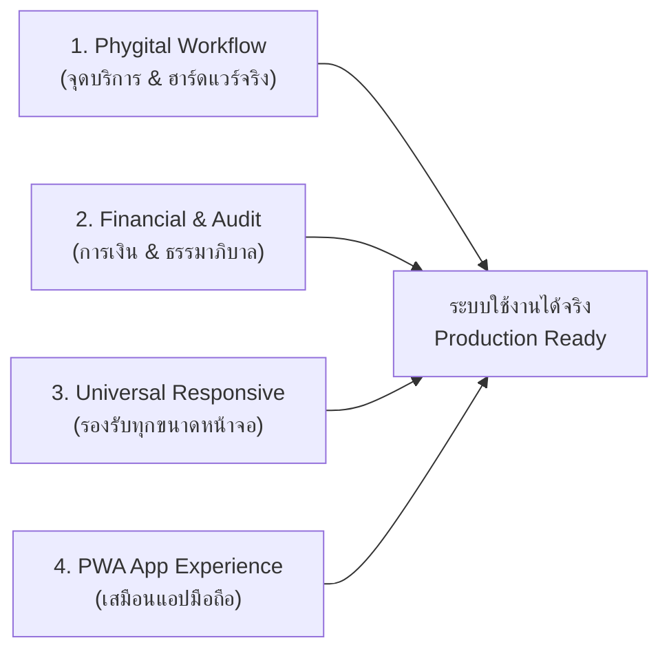
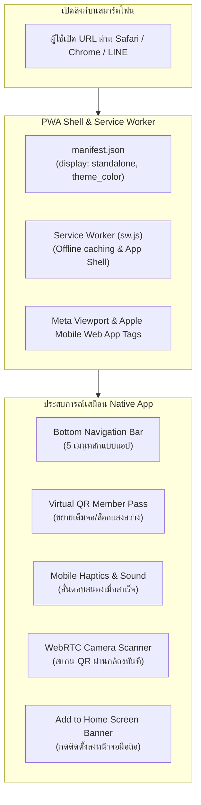
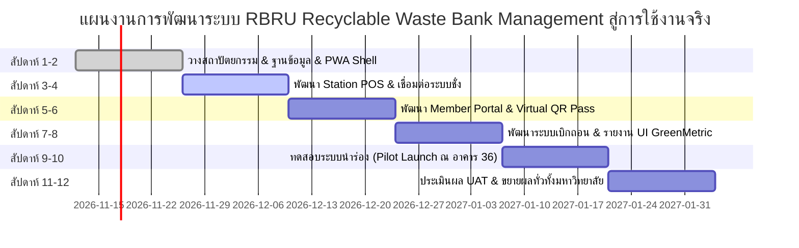

# แผนแม่บทการพัฒนาระบบ RBRU Recyclable Waste Bank Management สู่การใช้งานจริง
## Production-Grade Architecture, Universal Responsive Design & PWA Mobile App Experience

> **ระบบบริหารจัดการธนาคารขยะรีไซเคิล มหาวิทยาลัยราชภัฏรำไพพรรณี (RBRU Recyclable Waste Bank Management System)**  
> **แนวทางการขับเคลื่อน:** สู่การใช้งานจริง ณ จุดบริการมหาวิทยาลัย (Operational Phygital Bank), รองรับทุกขนาดหน้าจอ (Desktop, POS Touchscreen, Tablet, Mobile) และนำเสนอประสบการณ์แบบแอปพลิเคชันมือถือ (Progressive Web App - PWA) สำหรับสมาร์ตโฟน

---

## 1. บริบทและเป้าหมายการนำไปใช้งานจริง (Operational & Business Readiness)

เพื่อให้ระบบ **RBRU Recyclable Waste Bank Management** สามารถนำไปเปิดใช้งานจริงได้อย่างราบรื่นและยั่งยืนในมหาวิทยาลัยราชภัฏรำไพพรรณี แผนแม่บทนี้จึงกำหนดกรอบการดำเนินงานจริง (Operational Framework) 4 เสาหลัก:



### 1.1 การวางจุดบริการจริงในมหาวิทยาลัย (Physical Stations Workflow)
1. **จุดบริการกลาง (Central Depot - อาคาร 36 สำนักงานอธิการบดี):**
   * รองรับขยะรีไซเคิลทุกประเภท ปริมาณมากจากแม่บ้าน หอพัก และอาคารเรียน
   * อุปกรณ์ประจำจุด: PC/All-in-One Touchscreen, เครื่องชั่งดิจิทัลแบบแท่นใหญ่ (Heavy-duty Platform Scale 150-300 กก.), เครื่องสแกนบาร์โค้ด 2D/QR Code
2. **จุดบริการเคลื่อนที่/ย่อย (Satellite Stations - กองพัฒนานักศึกษา, โรงอาหาร, ลานหน้าอาคาร 40 คณะวิทย์ฯ):**
   * เปิดรับฝากตามตารางเวลาสัปดาห์ละ 1-2 ครั้ง
   * อุปกรณ์ประจำจุด: แท็บเล็ต/สมาร์ตโฟนเจ้าหน้าที่ (เปิดหน้า Station POS ผ่านเว็บแอป), เครื่องชั่งดิจิทัลพกพา (Luggage/Parcel Scale 50 กก.), สแกน QR ผ่านกล้องแท็บเล็ต
3. **การไหลของขยะ (Waste Flow) และการตรวจคัดแยก (Quality Control):**
   * ขยะต้องเทน้ำทิ้ง ล้างสะอาด และแยกหมวดหมู่ก่อนชั่ง
   * มีกระบวนการ Reject หรือปรับเกรดราคาหากขยะปนเปื้อน

### 1.2 วงจรการเงินและการตรวจสอบบัญชี (Financial & Governance Model)
1. **กลไกบัญชีเงินฝากเสมือน (Virtual Ledger):**
   * เงินที่ฝากขยะจะเครดิตเข้ากระเป๋าเงินดิจิทัล (Digital Wallet) ของสมาชิกทันที ไม่จำเป็นต้องจ่ายเงินสดหน้าร้าน ช่วยลดความเสี่ยงการถือเงินสดของเจ้าหน้าที่
2. **การขอเบิกถอนเงิน (Disbursement Rules):**
   * กำหนดขั้นต่ำการถอน (เช่น 50 บาทขึ้นไป)
   * โอนเข้าบัญชี PromptPay หรือโอนเข้าบัญชีสหกรณ์ออมทรัพย์/ร้านค้าสวัสดิการ มรภ.รำไพพรรณี
   * เจ้าหน้าที่การเงินของกองคลัง/คณะกรรมการตรวจสอบรายการก่อนอนุมัติโอน
3. **กองทุนธนาคารขยะ (Revolving Waste Fund):**
   * กำไรส่วนต่างจากการขายขยะให้โรงงานรีไซเคิลจะถูกจัดสรร:
     * 70% เข้ากองทุนสวัสดิการและเงินสำรองจ่ายหมุนเวียน
     * 20% พัฒนากิจกรรมสิ่งแวดล้อมและจัดหาอุปกรณ์ (ตราชั่ง, ถุงกระสอบ)
     * 10% รางวัลตอบแทน/ทุนการศึกษานักศึกษาจิตอาสาช่วยคัดแยก

---

## 2. ยุทธศาสตร์ Responsive ทุกขนาดจอ (Universal Responsive Architecture)

ระบบต้องรองรับหน้าจอตั้งแต่สมาร์ตโฟนขนาดเล็กไปจนถึงจอแดชบอร์ดขนาดใหญ่ โดยแบ่ง Breakpoints และลักษณะ UI ตามอุปกรณ์ดังนี้:

| ขนาดหน้าจอ (Breakpoint) | ประเภทอุปกรณ์ (Device Class) | บริบทการใช้งานหลัก (Primary Use Case) | รูปแบบเลย์เอาต์ (UI Adaptation) |
| :--- | :--- | :--- | :--- |
| **Mobile (< 640px)** | สมาร์ตโฟน iOS / Android | สมาชิกดูยอดเงิน, แสดง QR Card, เช็กราคา, สแกน | Single column, Bottom Navigation, Touch Gestures |
| **Tablet (641px - 1024px)** | iPad, Android Tablets, POS จอสัมผัส | เจ้าหน้าที่จุดรับฝากเคลื่อนที่, ตรวจนับสต็อก | Multi-column แบบพับได้, Large Touch Targets, Split View |
| **Desktop (1025px - 1440px)** | PC เจ้าหน้าที่ประจำจุด, พนักงานการเงิน | ชั่งน้ำหนักเร็ว, คีย์ข้อมูลด่วน, ออกรายงาน | Table-rich views, Keyboard shortcuts, Sticky Sidebar |
| **Large Display (> 1441px)** | จอคอมพิวเตอร์ผู้บริหาร, จอมอนิเตอร์ส่วนกลาง | แสดงผล UI GreenMetric Live Dashboard, อันดับขยะ | Multi-card KPI Grid, Live Streaming Charts, Fullscreen Mode |

---

## 3. สถาปัตยกรรม PWA: การแสดงผลเสมือนแอปพลิเคชันบนสมาร์ตโฟน

เมื่อผู้ใช้งาน (นักศึกษา/บุคลากร) เปิดระบบผ่านเบราว์เซอร์บนสมาร์ตโฟน ระบบจะตรวจจับและสลับเข้าสู่โหมด **App-Like PWA (Progressive Web App)** อัตโนมัติ:



### 3.1 คุณลักษณะเด่นของ Mobile App Mode
1. **Standalone Display Mode:** ซ่อน URL Bar และแถบนำทางของเบราว์เซอร์ ทำให้หน้าจอแสดงผลเต็มพื้นที่ 100% เสมือนแอปที่ติดตั้งจาก App Store / Play Store
2. **Bottom Navigation Bar (แถบเมนูด้านล่างแบบแอปพลิเคชัน):**
   * 🏠 **หน้าหลัก (Home):** ยอดเงินคงเหลือสะสม, kgCO2eq, การแจ้งเตือนล่าสุด
   * 🏷️ **ราคาวันนี้ (Prices):** ตรวจเช็กราคารับซื้อขยะทุกหมวดพร้อมตัวค้นหา
   * 💳 **บัตรของฉัน (My QR):** บัตรสมาชิกพร้อม Virtual QR Code สำหรับยื่นชั่ง
   * 📜 **สมุดบัญชี (Passbook):** ประวัติ Statement รายการฝาก-ถอนแบบ Drill-down
   * ⚙️ **โปรไฟล์ (Profile):** สังกัดคณะ ข้อมูลพร้อมเพย์ และการตั้งค่า
3. **Virtual QR Member Pass:**
   * ออกแบบบัตรสไตล์ Apple Wallet / Google Wallet แสดงชื่อ-สกุล, รหัสนักศึกษา, คณะ, และยอดเงินปัจจุบัน
   * มีปุ่มขยาย QR Code เต็มจอ พร้อมคำสั่งเพิ่มความสว่างหน้าจออัตโนมัติ เพื่อให้หัวอ่านบาร์โค้ด/กล้องแท็บเล็ตของจุดรับฝากสแกนติดง่ายในเสี้ยววินาที
4. **Offline Capability (ทำงานได้แม้อินเทอร์เน็ตหลุด):**
   * Service Worker แคช App Shell และข้อมูลบัตรสมาชิก (Offline QR Card) ไว้อย่างปลอดภัย แม้จุดรับฝากสัญญาณ 4G อับ ก็ยังเปิดบัตร QR ให้เจ้าหน้าที่สแกนได้

---

## 4. แผนผังหน้าจอและส่วนประกอบของระบบ (UI/UX Blueprint)

### 4.1 หน้าจอเจ้าหน้าที่จุดรับฝาก (Station POS - ชั่งน้ำหนักรวดเร็ว < 60 วินาที)
```text
+-------------------------------------------------------------------------------+
| RBRU Station POS | จุดบริการ: อาคาร 36 ศูนย์คัดแยก | จนท. สมคิด | วันที่: 12 พ.ย. 69 |
+-------------------------------------------------------------------------------+
| [1. สแกน QR สมาชิก]  [ ช่องค้นหา: รหัส นศ. / เบอร์ / ชื่อ ]                        |
| >> สมาชิก: 6614401001 น.ส.รักดี มีวินัย (คณะวิทย์ฯ) | ยอดคงเหลือ: 345.50 ฿      |
+------------------------------------+------------------------------------------+
| หมวดขยะ (Quick Select):             | รายการขยะในรอบนี้ (Current Basket):     |
| [ขวด PET ใส (9฿)]  [ลังกระดาษ (3฿)]  | 1. ขวด PET ใส      3.5 กก. =  31.50 ฿    |
| [กระป๋องอลู (35฿)] [กระดาษ A4 (4.5฿)] | 2. ลังกระดาษ      10.0 กก. =  30.00 ฿    |
| [ขวดแก้ว (1฿)]     [E-Waste (40฿)]   | 3. กระป๋องอลูมิเนียม 1.2 กก. =  42.00 ฿    |
|                                    | ---------------------------------------- |
| น้ำหนัก (กก.): [  3.500  ] [ชั่งสด]   | รวมน้ำหนัก: 14.700 กก. | ยอดเงิน: 103.50 ฿ |
| [ + เพิ่มรายการขยะลงบิล ]              | ลด CO2: 24.38 kgCO2eq  | แต้ม: +147 แต้ม  |
+------------------------------------+------------------------------------------+
|  [ ยกเลิกรายการ ]                    [ บันทึกรายการฝากเข้าบัญชี (Enter) ]        |
+-------------------------------------------------------------------------------+
```

### 4.2 หน้าจอมือถือสมาชิก (Mobile PWA Experience)
```text
+-----------------------------------+
| 09:41                        100% |
| RBRU Waste Bank                   |
+-----------------------------------+
| [ การ์ดสรุปยอดเงินสมาชิก ]          |
| ยอดเงินคงเหลือสะสม                 |
| ฿ 449.00                         |
| น้ำหนักขยะสะสม: 53.3 กก.            |
| ช่วยลด CO2: 80.8 kgCO2eq (🌳 8 ต้น)|
+-----------------------------------+
| [ บัตร Virtual QR Member Pass ]   |
| +-------------------------------+ |
| | น.ส.รักดี มีวินัย              | |
| | รหัส: 6614401001              | |
| | [    QR CODE สำหรับสแกน    ]    | |
| | แตะเพื่อขยายเต็มจอ             | |
| +-------------------------------+ |
+-----------------------------------+
| รายการฝากล่าสุด                   |
| 12 พ.ย. 69 • จุดบริการอาคาร 36     |
| +103.50 ฿ (14.7 กก.)  [ดูรายละเอียด]|
| 05 พ.ย. 69 • จุดบริการกองพัฒน์ นศ. |
| +54.00 ฿ (6.2 กก.)    [ดูรายละเอียด]|
+-----------------------------------+
| [🏠หน้าหลัก] [🏷️ราคา] [💳QR] [📜สมุด] [⚙️โปรไฟล์] |
+-----------------------------------+
```

---

## 5. แผนการจัดเตรียมทรัพยากรและฮาร์ดแวร์เพื่อใช้งานจริง (Deployment Stack)

### 5.1 ด้านซอฟต์แวร์และเซิร์ฟเวอร์
1. **Production Hosting:**
   * เซิร์ฟเวอร์ภายในของมหาวิทยาลัยราชภัฏรำไพพรรณี (ศูนย์เทคโนโลยีสารสนเทศ)
   * OS: Ubuntu Server 22.04 LTS / หรือ Windows Server พร้อม Apache, PHP 8.2+, MySQL 8.0+
   * SSL Certificate (HTTPS): บังคับใช้ HTTPS เพื่อให้ PWA และ Service Worker ทำงานได้สมบูรณ์ และเพื่อความปลอดภัยในการส่งข้อมูลธุรกรรม
2. **ระบบสำรองข้อมูล (Automated Backup Policy):**
   * Cron Job สำรองฐานข้อมูล MySQL ทุกวันเวลา 01.00 น.
   * บันทึก Transaction Log แยกไฟล์สำหรับตรวจสอบย้อนหลัง (Audit Trail)

### 5.2 ด้านอุปกรณ์ฮาร์ดแวร์ประจำจุดบริการ
1. **เครื่องชั่งดิจิทัล (Digital Scales):**
   * จุดใหญ่: ตราชั่งแท่นเหล็ก 150 กก. พร้อมพอร์ต RS232 หรือ USB สำหรับอ่านค่าน้ำหนักตรงเข้าหน้าเว็บผ่าน Web Serial API
   * จุดย่อย: ตราชั่งดิจิทัลแบบตั้งโต๊ะ 30 กก. ความละเอียด 5 กรัม
2. **เครื่องสแกนบาร์โค้ด/คิวอาร์โค้ด:**
   * หัวอ่านแบบ 2D Barcode Scanner (USB Plug & Play) ทำงานเหมือนคีย์บอร์ด ยิงสแกน QR หน้าจอมือถือสมาชิกได้ทันที
3. **เครื่องพิมพ์สลิปความร้อน (Thermal Receipt Printer 58mm/80mm):**
   * เชื่อมต่อผ่าน USB เพื่อพิมพ์ใบเสร็จสรุปยอดเงินและปริมาณขยะให้สมาชิกเก็บไว้เป็นหลักฐาน

---

## 6. แผนการดำเนินงานและกำหนดเวลา (Project Implementation Timeline)



---

## 7. เกณฑ์การประเมินความสำเร็จ (Key Performance Indicators - KPIs)

1. **ด้านความสะดวกรวดเร็ว (Operational Efficiency):**
   * เวลาเฉลี่ยในการรับฝาก ชั่งน้ำหนัก และออกสลิป ไม่เกิน **45 วินาทีต่อรายการ**
2. **ด้านการมีส่วนร่วมของประชาคม (Adoption Rate):**
   * มีนักศึกษาและบุคลากรลงทะเบียนเปิดบัญชีอย่างน้อย **1,500 บัญชี** ภายในภาคการศึกษาแรก
   * ทุกคณะ/หน่วยงาน (100%) มีบัญชีธนาคารขยะประจำคณะ เพื่อขับเคลื่อนสำนักงานสีเขียว (Green Office)
3. **ด้านผลสัมฤทธิ์สิ่งแวดล้อม (Environmental Impact):**
   * รวบรวมขยะรีไซเคิลออกจากระบบหลุมฝังกลบได้ไม่น้อยกว่า **25 ตัน (25,000 กก.)** ในปีแรก
   * ลดการปล่อยก๊าซเรือนกระจกสะสมได้ไม่น้อยกว่า **35,000 $\text{kgCO}_2\text{eq}$** เพื่อใช้เป็นข้อมูลหลักในการจัดอันดับ UI GreenMetric World University Rankings

